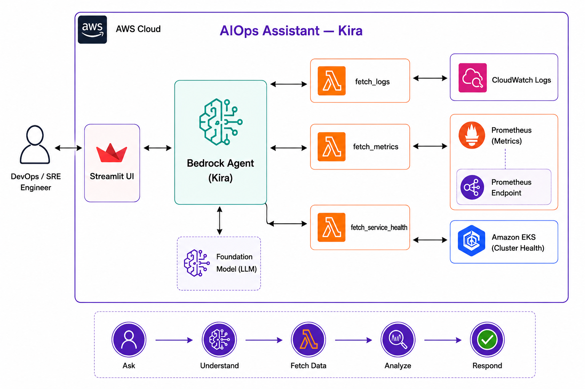

# 🤖 AIOps Assistant — Kira

## **An AI-Powered Site Reliability Engineering (SRE) Assistant Built with Amazon Bedrock Agents**

### Diagnose production incidents in seconds using **Amazon Bedrock Agents**, **AWS Lambda**, **Amazon CloudWatch**, **Prometheus**, **Amazon EKS**, and **Streamlit**.

<p align="center">
  
</p>

<p align="center">
  
</p>

<p align="center">
  
</p>
---

# 📖 Overview

**Kira** is an **AI-powered AIOps and Site Reliability Engineering (SRE) assistant** that helps DevOps engineers investigate production incidents through natural language conversations.

Instead of manually navigating multiple AWS consoles, querying CloudWatch Logs, writing PromQL queries, or inspecting Kubernetes resources, engineers can simply ask questions such as:

* *Why are users receiving HTTP 503 errors?*
* *Is CPU usage increasing across the cluster?*
* *Which pods are unhealthy?*
* *What is causing the service outage?*

Kira orchestrates **Amazon Bedrock Agents** with multiple AWS Lambda action groups to automatically collect operational data from **Amazon CloudWatch Logs**, **Prometheus metrics**, and **Amazon EKS cluster health**. It correlates this information to identify probable root causes, provide supporting evidence, and recommend actionable remediation steps.

---

## ✨ Key Features

* 🤖 AI-powered incident diagnosis using Amazon Bedrock Agents
* 📊 Retrieve infrastructure metrics directly from Prometheus
* 📜 Search and analyze CloudWatch Logs automatically
* ☸️ Monitor Amazon EKS cluster, node groups, and pod health
* 🔍 Correlate logs, metrics, and cluster status for root cause analysis
* 💡 Generate remediation recommendations with supporting evidence
---

<p align="center">
  
</p>

## Architecture

```
Streamlit UI (app.py)
      │
      ▼
Bedrock Agent (Kira)
      │
      ├── fetch_logs         → CloudWatch Logs
      ├── fetch_metrics      → Prometheus (ELB endpoint)
      └── fetch_service_health → EKS cluster + node groups
```

---

## Prerequisites

- AWS account with access to Bedrock (model access enabled for your chosen model)
- EKS cluster running with Prometheus exposed via a LoadBalancer service
- AWS CLI configured (`aws configure`)
- Python 3.10+

---

## Step 1: Set Up IAM Roles

Run the provided script to create both required IAM roles:

[setup-iam.sh](/projects/aiops-assistant/setup-iam.sh)

```bash
chmod +x setup-iam.sh
./setup-iam.sh
```

This creates:

| Role | Used By | Permissions |
|------|---------|-------------|
| `aiops-lambda-role` | All 3 Lambda functions | CloudWatch Logs read, EKS describe, Lambda basic execution |
| `aiops-bedrock-agent-role` | Bedrock Agent | Invoke the 3 Lambda functions, invoke Bedrock models |

---

## Step 2: Create the Lambda Functions

Create the following 3 Lambda functions in the AWS Console (or via CLI). Use the code from the `lambda/` directory.

| Function Name | Code File | Execution Role |
|---------------|-----------|----------------|
| `aiops-fetch-logs` | `lambda/fetch_logs/lambda_function.py` | `aiops-lambda-role` |
| `aiops-fetch-metrics` | `lambda/fetch_metrics/lambda_function.py` | `aiops-lambda-role` |
| `aiops-fetch-health` | `lambda/fetch_health/lambda_function.py` | `aiops-lambda-role` |

Runtime: **Python 3.12** | Timeout: **30 seconds**

---

## Step 3: Update the Prometheus URL

Both `fetch_metrics` and `fetch_health` lambdas query Prometheus directly. Update the `PROMETHEUS_URL` placeholder in each file before uploading the code.

In `lambda/fetch_metrics/lambda_function.py`:
```python
PROMETHEUS_URL = "http://<YOUR_PROMETHEUS_ELB_URL>:9090"
```

In `lambda/fetch_health/lambda_function.py`:
```python
PROMETHEUS_URL = "http://<YOUR_PROMETHEUS_ELB_URL>:9090"
```

To get the Prometheus ELB URL, expose Prometheus as a LoadBalancer service:

```bash
kubectl patch svc kube-prometheus-stack-prometheus -n monitoring \
  -p '{"spec": {"type": "LoadBalancer"}}'

kubectl get svc kube-prometheus-stack-prometheus -n monitoring
# Copy the EXTERNAL-IP value — that is your ELB URL
```

---

## Step 4: Deploy the Bedrock Agent

Run the deploy script. It will:
- Verify the Lambda functions and IAM role exist
- Set Lambda timeouts to 30s and add Bedrock invoke permissions
- Create the Bedrock Agent (`aiops-assistant`) with the Kira system prompt
- Attach all 3 action groups with their OpenAPI schemas
- Prepare the agent

[deploy.sh](/projects/aiops-assistant/deploy.sh)
```bash
chmod +x deploy.sh
./deploy.sh
```

At the end, the script prints your **Agent ID** — keep it for the next step.

---

## Step 5: Run the Streamlit UI

```bash
cp .env.example .env
```

Edit `.env` and fill in your values:

```env
AWS_REGION=us-east-1
BEDROCK_AGENT_ID=<YOUR_AGENT_ID>
BEDROCK_AGENT_ALIAS_ID=TSTALIASID

# Optional — omit to use your AWS CLI profile / SSO / IAM role:
# AWS_ACCESS_KEY_ID=<YOUR_ACCESS_KEY>
# AWS_SECRET_ACCESS_KEY=<YOUR_SECRET_KEY>
# AWS_SESSION_TOKEN=<YOUR_SESSION_TOKEN>
```

Install dependencies and start the UI:

[app.py](/projects/aiops-assistant/app.py)

```bash
pip install -r requirements.txt
streamlit run app.py
```

Open **http://localhost:8501** in your browser.

<p align="center">
  
</p>

---

## Project Structure

```
aiops-assistant/
├── app.py                  # Streamlit chat UI
├── deploy.sh               # Bedrock Agent deployment script
├── setup-iam.sh            # IAM roles and policies setup
├── requirements.txt        # Python dependencies
├── .env.example            # Environment variable template
├── lambda/
│   ├── fetch_logs/         # CloudWatch Logs query
│   ├── fetch_metrics/      # Prometheus metrics query
│   └── fetch_health/       # EKS cluster health check
├── schemas/
│   ├── fetch_logs.json     # OpenAPI schema for fetch_logs
│   ├── fetch_metrics.json  # OpenAPI schema for fetch_metrics
│   └── fetch_health.json   # OpenAPI schema for fetch_health

```

---

## Sample Questions to Ask Kira

- Why are we seeing 503 errors in the last hour?
- Is CPU usage high across the boutique services?
- Check database connections and latency
- Are all pods healthy? Any restarts?
- What are the most frequent errors in the last 2 hours?

---
