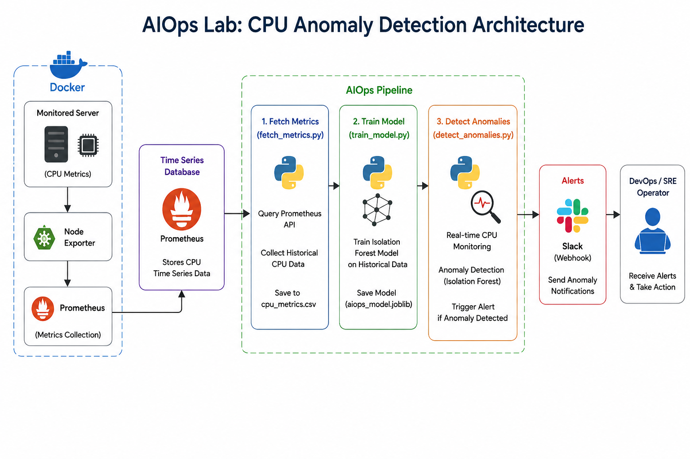
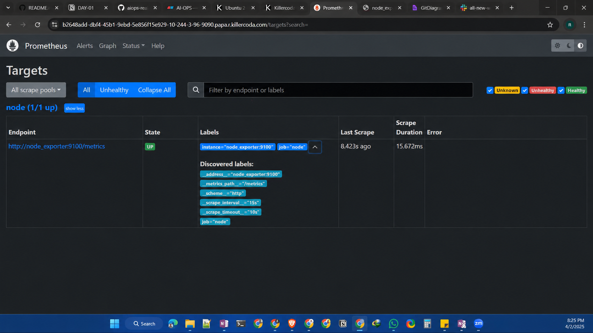
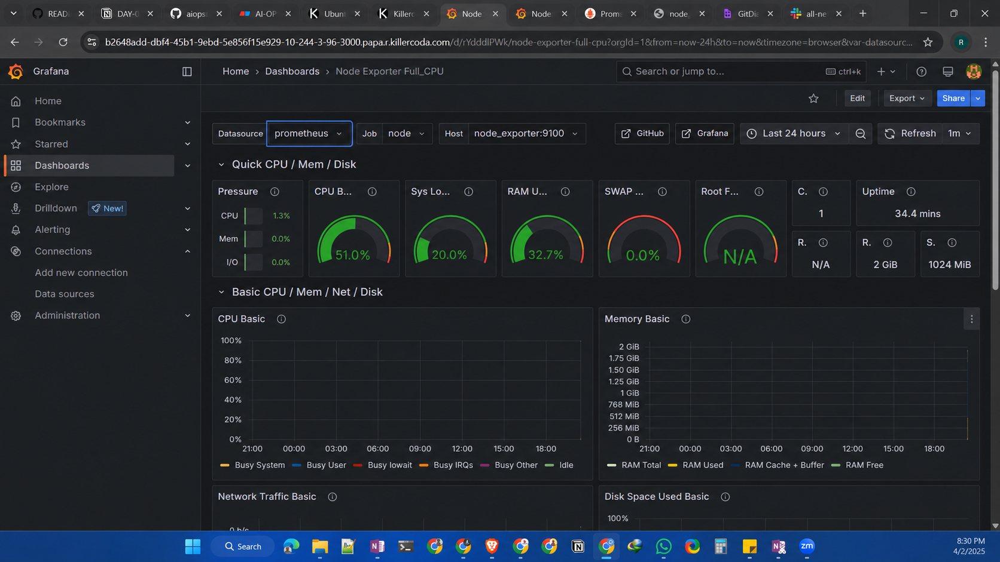
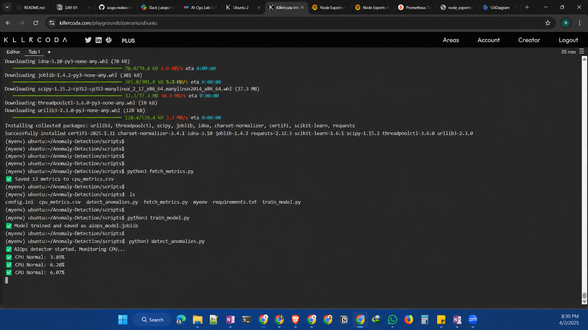
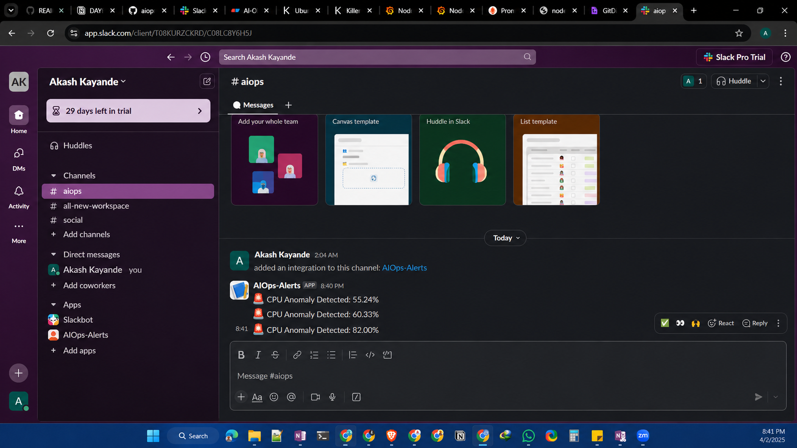

# 🚀 AIOps Lab: Intelligent CPU Anomaly Detection with Prometheus & Machine Learning

An end-to-end **AIOps project** that continuously monitors  CPU utilization, trains an **Isolation Forest Machine Learning model** on historical metrics, detects real-time CPU anomalies, and automatically sends **Slack alerts** for proactive incident response.

this project demonstrates how traditional monitoring can be enhanced with **AI-driven anomaly detection** to identify abnormal infrastructure behavior before it becomes a production incident.

---
<p align="center">
  
</p>

## ✨ Features

- 🚀 **Real-time Monitoring**: Track CPU usage with **Prometheus** and **Node Exporter**.
- 🔍 **Anomaly Detection**: Uses **Isolation Forest** to detect unusual CPU patterns.
- 📊 **Visualization**: Beautiful, interactive dashboards with **Grafana**.
- 🔔 **Alerts**: Get notified via **Slack** when anomalies occur.
- 🛠 **Easy Setup**: One-command **Docker deployment**.

---

## 📋 Prerequisites

Before you begin, ensure you have:

- 🐳 **Docker** & **Docker Compose** installed
- 🐍 **Python 3.8+**
- 🌐 **Git** (optional, for cloning the repo)
- 💬 **Slack Webhook URL** (optional, for alerts)

---

## 🚀 Quick Start Guide

### Step 1: Set Up the Environment

```bash
# Clone the repository (optional)
git clone https://github.com/akashkayande/AI-Assisted-DevOps.git

# Install Docker dependencies (if not already installed)
sudo apt-get update
sudo apt-get install -y docker.io docker-compose

# Install Python dependencies
pip install -r scripts/requirements.txt

# Install additional dependencies
pip install pandas requests scikit-learn
```

### Step 2: Launch the Monitoring Stack

```bash
docker-compose up -d
```
## 🎨 Visualization

- **Prometheus**: Visit 👉 [http://localhost:9090](http://localhost:9090)
- **Grafana**: Go to 👉 [http://localhost:3000](http://localhost:3000) (**default login**: admin/admin)
- **Add Prometheus Datasource**: `http://prometheus:9090`
- **Import Dashboard ID**: `1860 (Node Exporter Full)`

---
<p align="center">
  
</p>

<p align="center">
  
</p>

---

### Step 3: Run the AIOps Pipeline

```bash
cd scripts
python3 fetch_metrics.py    # Collect 6 hours of CPU data
python3 train_model.py      # Train the anomaly detection model
python3 detect_anomalies.py # Start real-time monitoring
```

<p align="center">
  
</p>

### Step 4: Test the System

```bash
# Install stress-ng (Ubuntu/Debian)
sudo apt-get install -y stress-ng

# Simulate CPU load
stress-ng --cpu 2 --timeout 120s
```

---

## 🔔 Slack Notifications

1. **Create a Slack webhook**: [Slack Webhooks Guide](https://api.slack.com/messaging/webhooks)
2. **Edit `scripts/config.ini`** and replace `YOUR_SLACK_WEBHOOK_URL` with your webhook URL.

<p align="center">
  
</p>
---

## 🛠️ Troubleshooting

- 🔄 **Check Docker**: `docker ps` (ensure all services are running)
- 📜 **View Logs**: `docker-compose logs`
- 📊 **Data Issues**: Verify `cpu_metrics.csv` exists and contains data

---
