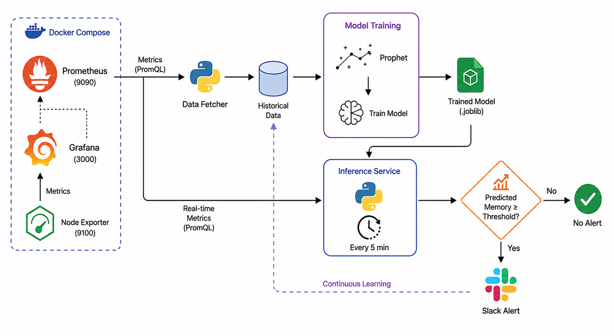
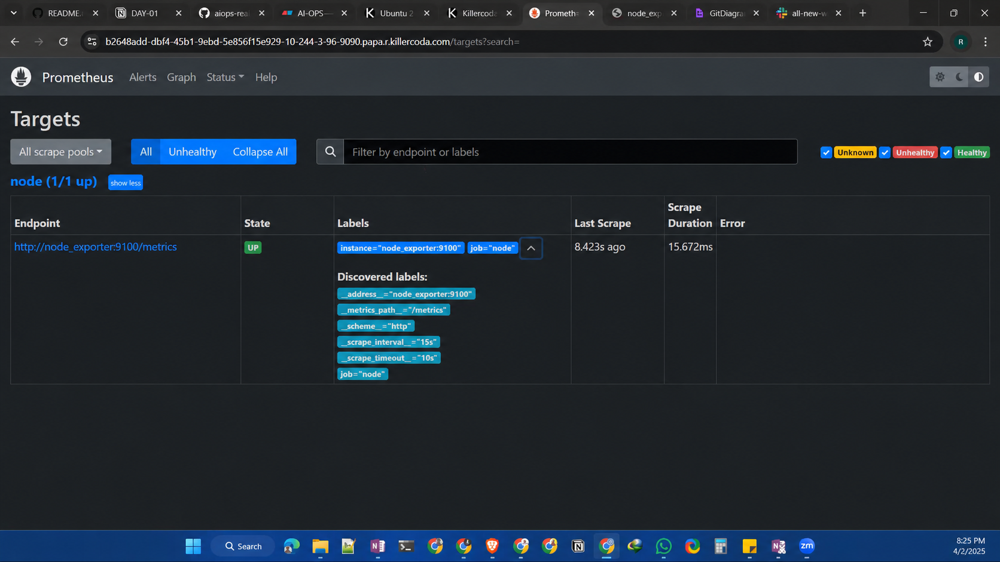
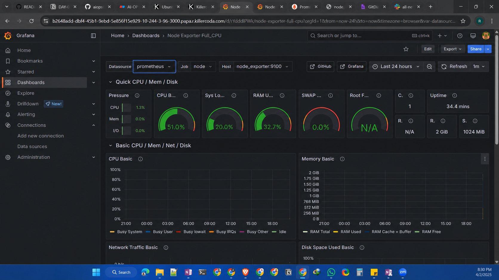
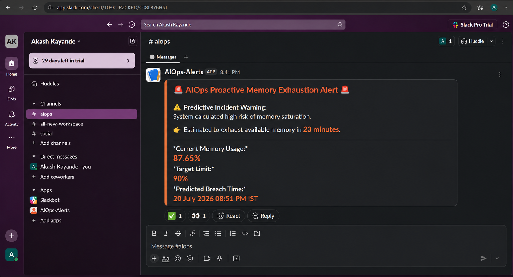

# 🌟 AIOps Lab: Predictive Memory Exhaustion Detection with Prophet 🌟

> **Predict infrastructure incidents before they happen.**
>
> This project uses **Prophet**, **Prometheus**, **Grafana**, and **Slack** to forecast future memory utilization and proactively alert engineers before a server reaches critical memory usage.

---

## 📖 Overview

Traditional monitoring tools notify engineers **after** CPU or memory usage crosses a threshold.

This project takes a different approach.

Instead of reacting to incidents, it continuously learns historical memory usage patterns from Prometheus using the **Prophet Time Series Forecasting Model** and predicts whether memory usage will reach a dangerous level in the near future.

If the model predicts memory utilization will exceed **95% within the next 2 hours**, a proactive Slack notification is sent so engineers can investigate before production is affected.

---
<p align="center">
  
</p>

---

# 🚀 Features

- 📈 Forecast future memory utilization using Prophet
- 📊 Collect historical metrics directly from Prometheus
- 🖥 Monitor Linux host memory through Node Exporter
- 🔮 Predict memory saturation up to 2 hours ahead
- 🚨 Send proactive Slack alerts before incidents occur

---

## 📋 Prerequisites

Before you begin, ensure you have:

- 🐳 **Docker** & **Docker Compose** installed
- 🐍 **Python 3.8+**
- 🌐 **Git** (optional, for cloning the repo)
- 💬 **Slack Webhook URL** (optional, for alerts)

---

## 🚀 Quick Start Guide

### Step 1: Set Up the Environment

```bash
# Clone the repository (optional)
git clone https://github.com/akashkayande/AI-Assisted-DevOps.git

# Install Docker dependencies (if not already installed)
sudo apt-get update
sudo apt-get install -y docker.io docker-compose

# Install Python dependencies
pip install -r scripts/requirements.txt

```

### Step 2: Launch the Monitoring Stack

```bash
docker-compose up -d
```

### 🎨 Visualization

- **Prometheus**: Visit 👉 [http://localhost:9090](http://localhost:9090)
- **Grafana**: Go to 👉 [http://localhost:3000](http://localhost:3000) (**default login**: admin/admin)
- **Add Prometheus Datasource**: `http://prometheus:9090`
- **Import Dashboard ID**: `1860 (Node Exporter Full)`

---
<p align="center">
  
</p>

<p align="center">
  
</p>

---

### Step 3: Run the AIOps Pipeline

- [train.py ](/AIOPS-AI-base-observibility/incident-prediction/scripts/train.py)

- [predict_and_alert.py](/AIOPS-AI-base-observibility/incident-prediction/scripts/predict_and_alert.py)

```bash
cd scripts
python3 train.py    
python3 predict_and_alert.py      
```

### Step 4: Test the System

* Generate Load On System

```bash
# Install stress-ng (Ubuntu/Debian)
sudo apt-get install -y stress-ng

# Simulate CPU load
stress-ng --cpu 2 --timeout 120s
```

---


## 🔔 Slack Notifications

1. **Create a Slack webhook**: [Slack Webhooks Guide](https://api.slack.com/messaging/webhooks)
2. **Edit `scripts/config.ini`** and replace `YOUR_SLACK_WEBHOOK_URL` with your webhook URL.

<p align="center">
  
</p>
---

## 🛠️ Troubleshooting

- 🔄 **Check Docker**: `docker ps` (ensure all services are running)
- 📜 **View Logs**: `docker-compose logs`
- 📊 **Data Issues**: Verify `cpu_metrics.csv` exists and contains data

---