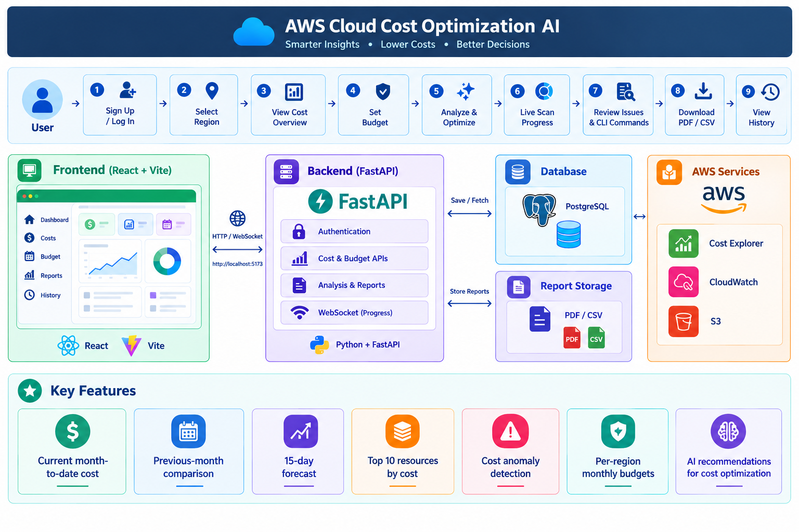
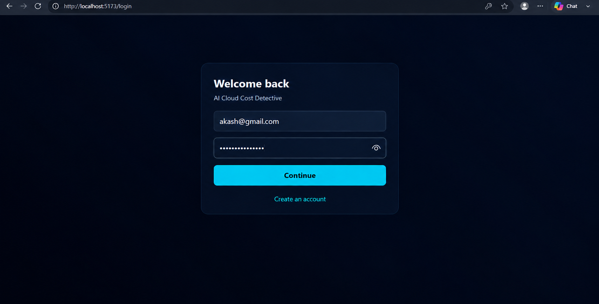
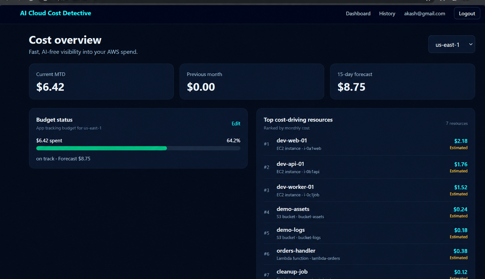
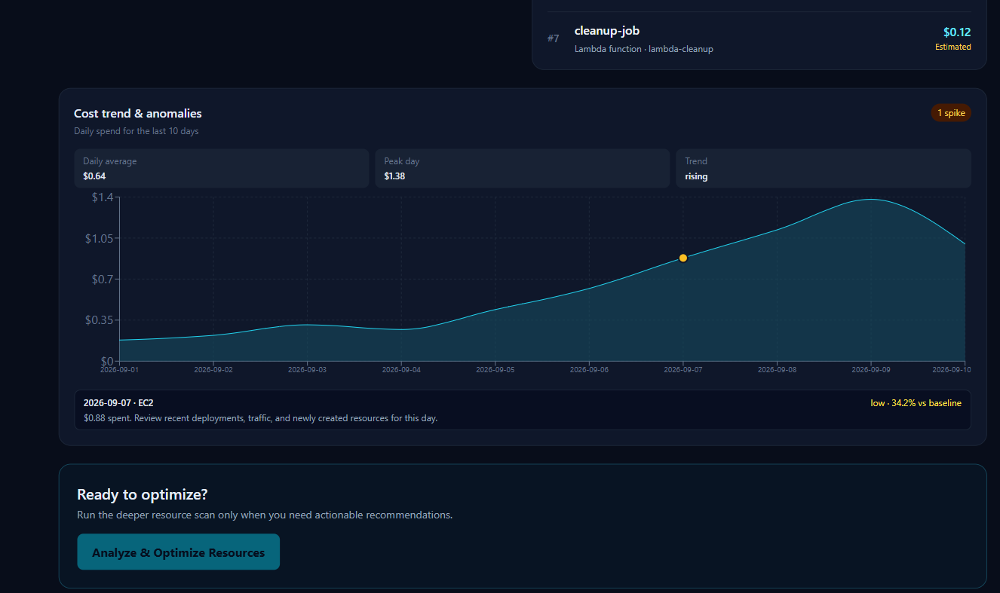
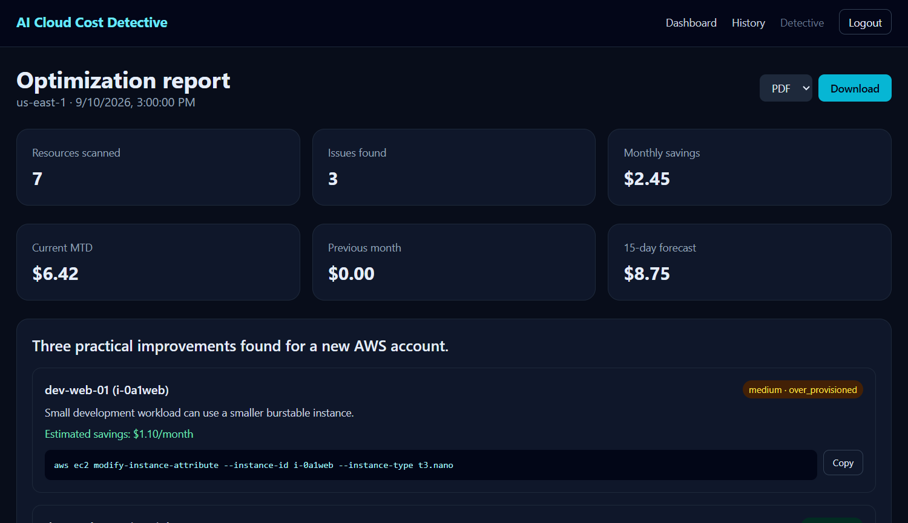
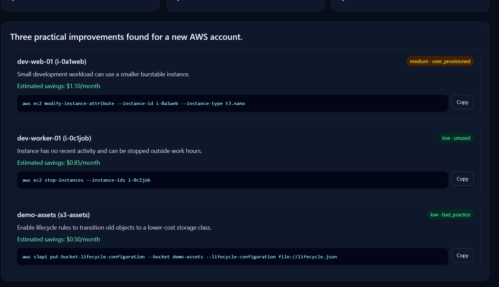
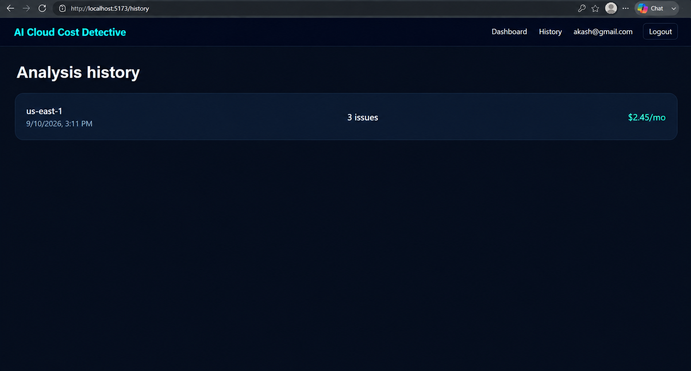

# 🚀 AI Cloud Cost Detective

> **AWS cost visibility, budget tracking, anomaly detection, and AI-powered
> resource optimization in one dashboard.**

---
## 📌 Overview

- A **full-stack AWS cost optimization platform**.
- Loads a fast cost dashboard when a region is selected.
- Runs a separate deep resource scan when requested.
- Stores users, budgets, analyses, and cost snapshots in PostgreSQL.
- Streams scan progress over WebSockets.
- Exports completed reports as **PDF** or **CSV**.

> **Note:** Live AWS data requires an AWS account, AWS CLI credentials, and
> suitable IAM permissions.

---


---
## Application Screenshots

<p align="center">
  
</p>

---
<p align="center">
  
</p>


<p align="center">
  
</p>

---
### Click On Analyze & Optimize Resources

- **Calls POST /api/analyze.**
- **Scans AWS resources and costs.**
- **Calls the AI service.**
- **Saves the completed analysis/report in the database.**
- **Redirects to /report/{analysis_id}.**

<p align="center">
  
</p>

<p align="center">
  
</p>

---
### History Tab

- **Displays previously completed reports**
- **Allows users to view and download past reports**

<p align="center">
  
</p> 

**Click On Analysis History Item**

- **Opens /report/{analysis_id}.**
- **Calls GET /api/report/{analysis_id}/data.**
- **Reads the saved AI result from the database.**
- **Does not call AI again.**

<p align="center">
  
</p>

---

## Why this project?

### Problem

- Cloud spending is spread across multiple services and regions.
- Expensive or idle resources are difficult to identify.
- Billing data does not always explain which resource needs attention.
- Manual investigation is slow and repetitive.

### Solution

- Combines **Cost Explorer**, AWS CLI resource discovery, budgets, and AI.
- Shows current, previous, and forecasted spend.
- Ranks top cost-driving resources.
- Detects unusual spending.
- Provides actionable recommendations with **copyable AWS CLI commands**.

---
## Features

### Cost intelligence

- Current month-to-date cost
- Previous-month comparison
- 15-day forecast
- Top 10 resources by cost
- Exact or estimated cost-basis labels
- Daily cost trend chart
- Cost anomaly detection
- 15-minute in-memory Cost Explorer cache

### Optimization

- Cost-driven resource scanning
- EC2, RDS, S3, Lambda, and other service discovery
- AI recommendations for:
  - `over_provisioned`
  - `unattached`
  - `unused`
  - `misconfigured`
  - `bad_practice`
- Severity levels: **high**, **medium**, **low**
- Estimated monthly and yearly savings
- Copyable AWS CLI remediation commands

### Budgets and reports

- Per-region monthly budgets
- `on_track`, `warning`, and `exceeded` statuses
- PostgreSQL analysis history
- Live WebSocket progress tracking
- PDF reports
- CSV exports

## Technology stack

| Area | Technologies |
|---|---|
| **Frontend** | React, TypeScript, Vite, Tailwind CSS, Recharts |
| **Backend** | Python, FastAPI, Uvicorn, Pydantic |
| **Database** | PostgreSQL 15, asyncpg |
| **Cloud integration** | AWS CLI, Cost Explorer |
| **AI** | OpenAI API |
| **Reports** | ReportLab, Python CSV |

---

## Screenshots

> Demo screenshots use safe sample data: 3 EC2 instances, 2 S3 buckets, 2 Lambda functions, and a $10 monthly app budget.

| Login | Signup | Dashboard |
|---|---|---|
|  |  |  |

| History | Optimization report | Resource costs |
|---|---|---|
|  |  |  |

---

## How it works

1. User signs up or logs in.
2. Frontend stores the JWT in `localStorage`.
3. User selects an AWS region.
4. Cost and budget requests load independently.
5. User starts the optimization scan.
6. Backend discovers active services and resources.
7. AI analyzes cost-driving resources.
8. Results are stored in PostgreSQL.
9. Progress is sent through WebSocket.
10. User reviews and downloads the report.

## Project structure

```text
├── backend/
│   ├── main.py
│   ├── aws_client.py
│   ├── aws_scanner.py
│   ├── cost_intelligence.py
│   ├── budget_engine.py
│   ├── ai_analyzer.py
│   ├── db.py
│   ├── ws_manager.py
│   ├── report_generator.py
│   ├── requirements.txt
│   └── .env.example
├── frontend/
│   ├── src/
│   │   ├── components/
│   │   ├── pages/
│   │   ├── api.ts
│   │   └── App.tsx
│   ├── package.json
│   └── vite.config.ts
└── README.md
```

## Setup

### Prerequisites

- **Python 3.11+**
- **Node.js 18+**
- **Docker Desktop**
- **AWS CLI**
- AWS account for live AWS data

Verify:

```powershell
python --version
node --version
docker --version
aws --version
```

### 1. Start PostgreSQL

```powershell
docker run -d `
  --name pg_cost_detective `
  -e POSTGRES_USER=postgres `
  -e POSTGRES_PASSWORD=your-postgres-password `
  -e POSTGRES_DB=cloud_cost_detective `
  -p 5433:5432 `
  postgres:15
```

### 2. Configure backend

```powershell
cd backend
Copy-Item .env.example .env
```

Edit `backend/.env`:

```env
OPENAI_API_KEY=
OPENAI_MODEL=gpt-4o
AI_ENABLED=false

DATABASE_URL=
DB_USER=postgres
DB_PASSWORD=your-postgres-password
DB_HOST=127.0.0.1
DB_PORT=5433
DB_NAME=cloud_cost_detective

JWT_SECRET=use-a-long-random-secret
```

- Set `AI_ENABLED=true` only when `OPENAI_API_KEY` is configured.
- Never commit `.env` or API keys.

### 3. Configure AWS CLI

For live AWS data:

```powershell
aws configure
aws sts get-caller-identity
```

The IAM identity needs read access to **Cost Explorer** and the AWS services
being scanned.

### 4. Install and run backend

```powershell
cd backend
python -m venv .venv
.\.venv\Scripts\Activate.ps1
pip install -r requirements.txt
python -m uvicorn main:app --reload --host 0.0.0.0 --port 8000
```

Backend URLs:

- API: `http://localhost:8000`
- Swagger: `http://localhost:8000/docs`

### 5. Install and run frontend

Open a second terminal:

```powershell
cd frontend
npm install
npm run dev
```

Open: `http://localhost:5173`

## User flow

1. **Create an account**
2. **Log in**
3. **Select a region**
4. Review the **Cost Overview**
5. Set a monthly **budget**
6. Click **Analyze & Optimize Resources**
7. Watch live scan progress
8. Review issues and CLI commands
9. Download **PDF** or **CSV**
10. Reopen reports from **History**

## API overview

### Authentication

- `POST /api/auth/signup`
- `POST /api/auth/login`

### Costs and budgets

- `GET /api/regions`
- `GET /api/cost/current`
- `GET /api/cost/previous-month`
- `GET /api/cost/forecast`
- `GET /api/cost/top-resources`
- `GET /api/cost/anomalies`
- `GET /api/budget`
- `POST /api/budget`

### Analysis and reports

- `POST /api/analyze`
- `GET /api/history`
- `GET /api/report/{id}/data`
- `GET /api/report/{id}/download?format=pdf`
- `GET /api/report/{id}/download?format=csv`
- `ws://localhost:8000/ws/progress/{id}?token=<jwt>`


## 🧑‍💻 Author

**Akash Kayande**
DevOps | AWS | AI | Developer 

---
⭐ If you like this project
Give it a ⭐ on GitHub and feel free to fork or raise issues! 