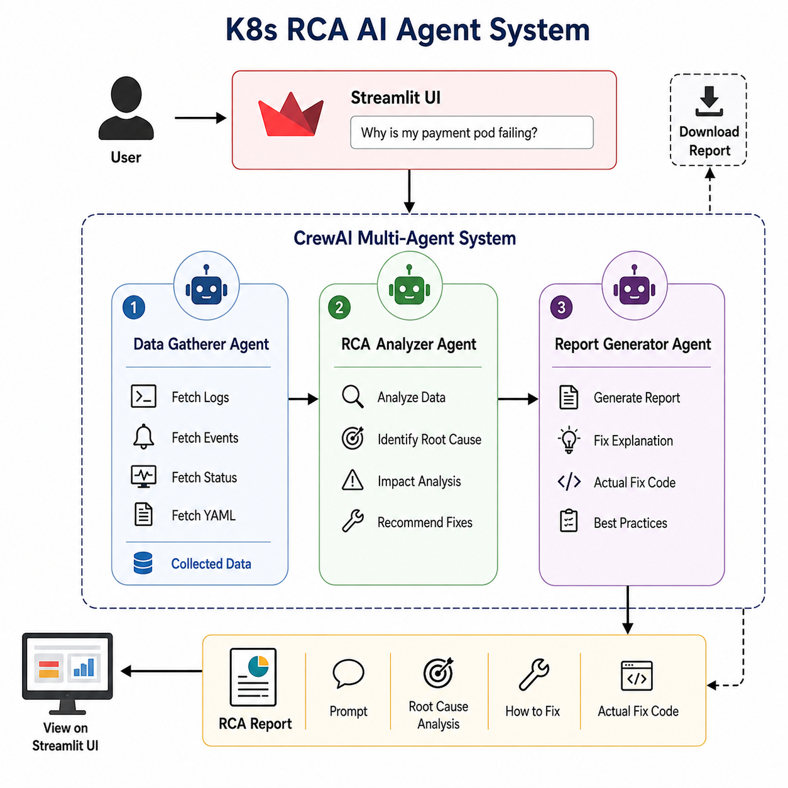

# ☸️ Kubernetes AI Root Cause Analysis Agent **(CrewAi)**

## Overview

**Kubernetes AI Root Cause Analysis Agent** is a multi-agent AI-powered troubleshooting system that helps DevOps and SRE teams investigate failing Kubernetes pods.

Instead of manually running multiple `kubectl` commands, checking logs, reviewing events, inspecting pod manifests, and correlating all of that information, the user can simply describe the problem through a **Streamlit UI**.

For example:

> Why is my payment pod failing or crash looping?

The application starts a **CrewAI multi-agent workflow**:

1. **Data Gatherer Agent** collects evidence from the Kubernetes cluster.
2. **RCA Analyst Agent** correlates the evidence and determines the technical root cause.
3. **DevOps Reporter Agent** produces a structured incident report containing the root cause, remediation steps, commands, and Kubernetes YAML fixes.

The final RCA report is displayed directly in the Streamlit UI and can be downloaded as a Markdown file.

---

<p align="center">
  
</p>

---

## 🎯 Why Do We Need This?

Kubernetes failures can be difficult to troubleshoot because the actual cause is often distributed across multiple sources.

The visible pod status is often only the **symptom**, not the root cause.

A traditional investigation might require an engineer to run several commands:

- `kubectl get pod`
- `kubectl describe pod`
- `kubectl logs`
- `kubectl get events`
- `kubectl get pod -o yaml`

This project automates that investigation using specialized AI agents.

### Problems Solved

| Traditional Troubleshooting | AI RCA Agent |
|---|---|
| Manually collect logs | Automatically collects logs |
| Manually inspect events | Automatically retrieves pod events |
| Manually inspect pod status | Dedicated diagnostic agent |
| Manually inspect YAML | Automatically analyzes configuration |
| Manually correlate evidence | RCA agent correlates evidence |
| Write incident report manually | Reporter agent generates report |
| Search for remediation commands | Generates evidence-based remediation |
| Copy findings into documentation | Downloadable Markdown report |

The goal is not simply to ask an LLM, *"What is wrong with my pod?"*

The goal is to provide the LLM with **real Kubernetes telemetry first**, and then let specialized agents reason over that evidence.

---

# ✨ Features

## 1. Multi-Agent Kubernetes Troubleshooting

The application uses three specialized CrewAI agents:

### 🔎 Agent 1 — Kubernetes Data Gatherer

Responsible only for collecting evidence.

It retrieves:

- Pod logs
- Kubernetes events
- Pod status
- Container restart counts
- Pod conditions
- Pod YAML manifest
- Resource limits and requests


The agent is intentionally instructed **not to solve the incident**.

Its job is to collect reliable evidence for the next agent.

---

### 🧠 Agent 2 — RCA Analyst

The RCA Analyst receives the diagnostic data collected by Agent 1.

It performs:

- Failure classification
- Evidence correlation
- Log analysis
- Event analysis
- YAML/configuration verification
- Failure mechanism identification

The agent is instructed not to guess. It must correlate the evidence before determining the root cause.

---

### 🛠️ Agent 3 — DevOps Reporter

The final agent converts the RCA into an actionable incident report.

The report contains:

- Incident summary
- Root Cause Analysis
- Evidence
- Immediate fix
- Permanent fix
- `kubectl` commands
- Kubernetes YAML remediation
- Explanation of why the fix works

The reporter follows a safety-oriented approach and is instructed to avoid inventing Kubernetes resources or unsupported commands.

---

## 2. Real Kubernetes Cluster Data

The AI does not troubleshoot from hypothetical information.

The application connects to the Kubernetes cluster using the Python Kubernetes client and retrieves real-time information.

The diagnostic tools include:

- `Get Pod Logs`
- `Get Pod Events`
- `Get Pod Status`
- `Get Pod YAML`

---

## 3. Streamlit User Interface

The application provides a simple UI where the user enters:

- Pod name
- Namespace
- Problem description


The user then clicks:

**Generate RCA Report**

---

## 4. Downloadable RCA Report

After analysis is completed, the generated report is displayed in Streamlit.

The user can download the complete incident report as:

```text
<pod-name>_RCA_<timestamp>.md
```

This makes the output useful for:

- Incident documentation
- Postmortems
- Developer handoffs
- SRE investigations
- Support tickets
- Knowledge bases

---

# 🧰 Tech Stack

| Technology | Purpose |
|---|---|
| Python | Application and agent implementation |
| CrewAI | Multi-agent orchestration |
| OpenAI | LLM reasoning |
| LangChain OpenAI | OpenAI model integration |
| Kubernetes Python Client | Kubernetes API interaction |
| Streamlit | Web interface |

---


# 📋 Example Investigation Flow

Suppose the user asks:

```text
Why is my payment pod crash looping?
```

The workflow may look like:

```text
User Query
    ↓
Streamlit
    ↓
CrewAI
    ↓
Data Gatherer
    │
    ├── Pod Status
    ├── Pod Events
    ├── Pod Logs
    └── Pod YAML
    ↓
Raw Diagnostic Evidence
    ↓
RCA Analyst
    │
    ├── Classify
    ├── Correlate
    └── Verify
    ↓
Root Cause
    ↓
DevOps Reporter
    │
    ├── Incident Summary
    ├── Root Cause
    ├── Immediate Fix
    └── Permanent YAML Fix
    ↓
Streamlit
    ↓
Download RCA Report
```

---

# 📁 Project Structure


```text
K8-RCA-Agent/
│
├── app.py
├── crew.py
├── requirements.txt
├── .env
├── .gitignore
│
├── tools/
│   └── k8s_tools.py
│
└── config/
    ├── agents.yaml
    └── tasks.yaml
```

### File Responsibilities

| File | Responsibility |
|---|---|
| `app.py` | Streamlit UI and execution flow |
| `crew.py` | CrewAI agents, tasks, and crew definition |
| `tools/k8s_tools.py` | Kubernetes API tools |
| `config/agents.yaml` | Agent roles, goals, and backstories |
| `config/tasks.yaml` | Agent task instructions |
| `.env` | API/model configuration |
| `requirements.txt` | Python dependencies |

---

# 🚀 Step-by-Step Implementation Guide

## Step 1 — Prerequisites

Before starting, install:

- Python 3.10+
- Kubernetes cluster
- `kubectl`
- Access to the target Kubernetes cluster
- OpenAI API key

You can use a local cluster such as:

- Minikube
- Kind
- Docker Desktop Kubernetes

Or connect the application to an existing development/staging/production cluster.

---

# Step 3 — Create a Python Virtual Environment

Create the virtual environment:

```bash
python -m venv venv
```

Activate it on Linux/macOS:

```bash
source venv/bin/activate
```

---

# Step 4 — Install Dependencies

```bash
pip install -r requirements.txt
```

A typical dependency list is:

```text
crewai
streamlit
kubernetes
pyyaml
langchain-openai
python-dotenv
```

---

# Step 5 — Configure the OpenAI API Key

Create a `.env` file:

```env
OPENAI_API_KEY=your_openai_api_key
OPENAI_MODEL_NAME=gpt-4o
```

Never commit `.env` to Git.

Add it to `.gitignore`:

```text
.env
venv/
__pycache__/
```
---

# Step 6 — Configure Kubernetes Access


```text
~/.kube/config
```

Verify that Kubernetes access works:

```bash
kubectl cluster-info
```

Then verify the target namespace:

```bash
kubectl get pods -n default
```
---

# Step 7 — Implement Kubernetes Tools

Create:

```text
tools/k8s_tools.py
```

The four tools are:

```text
get_pod_logs()
get_pod_events()
get_pod_status()
get_pod_yaml()
```
---

# Step 8 — Define the Agents

Create:

```text
config/agents.yaml
```

Define three agents.

### Agent 1

```text
Senior Kubernetes Diagnostics Engineer
```

Responsibility:

```text
Collect evidence only.
```

### Agent 2

```text
Principal Kubernetes Architect
```

Responsibility:

```text
Analyze evidence and determine root cause.
```

### Agent 3

```text
Platform Engineering Lead
```

Responsibility:

```text
Create an actionable incident report and remediation.
```

This separation of responsibilities is important.

Instead of one large agent trying to do everything, each agent has a clear role.

---

# Step 9 — Define the Tasks

Create:

```text
config/tasks.yaml
```

The three tasks should execute in this order:

```text
gather_data_task
        ↓
analyze_data_task
        ↓
generate_report_task
```

The first task gathers raw telemetry.

The second task receives the first task's output as context.

The third task receives the RCA as context.

---

# Step 10 — Build the CrewAI Workflow

Create:

```text
crew.py
```
[crew.py](/CrewAi-Agents/K8-RCA-Agent/crew.py)
---

# Step 12 — Build the Streamlit UI

Create:

```text
app.py
```

---

# Step 15 — Run the Application

Start Streamlit:

```bash
streamlit run app.py
```

The application will start a local web server.

Open the displayed Streamlit URL in your browser.

---

# 🧪 Step 16 — Test the System

Then enter the pod name into the Streamlit application.

Example:

```text
Pod Name:
payment-service-xxxxx

Namespace:
default

Issue:
Why is my payment pod failing?
```

Click:

```text
Generate RCA Report
```

---
