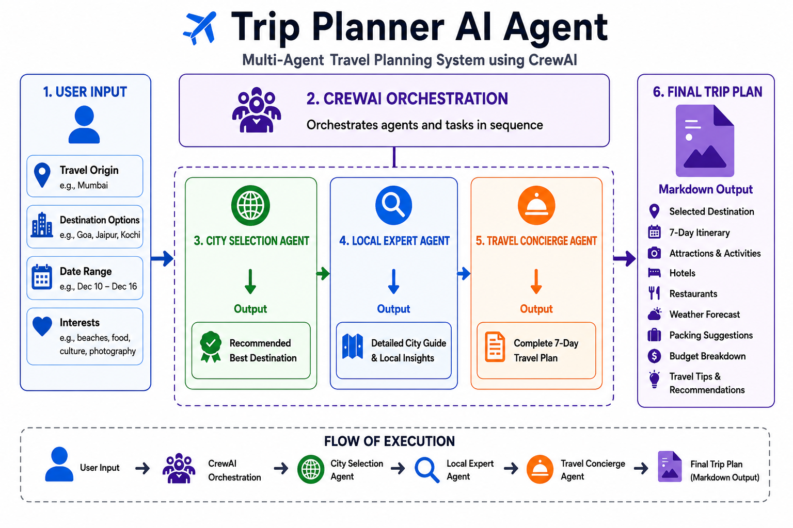

# ✈️ Trip Planner AI Agent
---
## Overview

Trip Planner AI Agent is a multi-agent travel planning application built with **CrewAI**. It uses specialized AI agents to research destinations, gather local insights, and create a personalized **7-day travel itinerary**.

The application accepts a travel origin, destination options, travel dates, and traveler interests. The CrewAI workflow then coordinates multiple agents that use internet search and calculation tools to produce a practical travel plan with destinations, hotels, restaurants, activities, weather information, packing suggestions, and a budget breakdown.

---
<p align="center">
  
</p>

---

## Why Do We Need This?

Planning a trip manually often requires searching across many websites for flights, weather, attractions, hotels, restaurants, events, and prices. This can be time-consuming and difficult to organize.

This project uses AI agents to automate that research and planning process.

Instead of performing all the research yourself, you provide a few travel preferences and the agents collaborate to:

- Compare destination options.
- Research current travel information.
- Understand local attractions and customs.
- Find relevant hotels, restaurants, and activities.
- Build a day-by-day itinerary.
- Estimate the overall trip budget.
- Personalize recommendations around traveler interests.

---

## Features

- 🤖 **Multi-Agent Architecture** — Three specialized CrewAI agents collaborate on the trip.
- 🌍 **Destination Selection** — Compares cities using weather, season, events, and travel costs.
- 🔎 **Internet Research** — Uses Serper Google Search API to retrieve current travel information.
- 🧭 **Local Expert Research** — Provides attractions, cultural information, hidden gems, and local recommendations.
- 🏨 **Travel Recommendations** — Suggests actual hotels, restaurants, attractions, and activities.
- 📅 **7-Day Itinerary** — Generates a detailed day-by-day travel plan.
- 💰 **Budget Calculation** — Uses a calculation tool to estimate and organize trip costs.
- 🎒 **Packing Suggestions** — Generates packing recommendations based on the itinerary and expected weather.
- 🌦️ **Weather-Aware Planning** — Incorporates weather information into destination selection and itinerary planning.
- 📝 **Markdown Output** — Produces the final travel plan in a readable Markdown format.
- 🔄 **Agent Collaboration** — Tasks are executed sequentially by specialized agents through CrewAI.

---

## Tech Stack

| Technology | Purpose |
|---|---|
| **Python** | Application development |
| **CrewAI** | Multi-agent orchestration |
| **OpenAI GPT-3.5 Turbo** | LLM reasoning and generation |
| **LangChain OpenAI** | LLM integration |
| **Serper API** | Internet / Google search |

---

## Architecture

The application follows a simple multi-agent workflow:

**User Input → CrewAI → City Selection Agent → Local Expert Agent → Travel Concierge Agent → Final Trip Plan**

---

### 1. City Selection Agent

The City Selection Agent analyzes the available destination options.

It uses internet search to research:

- Weather
- Seasonal conditions
- Events
- Attractions
- Flight/travel costs
- Destination suitability

It then recommends the most suitable city.

---

### 2. Local Expert Agent

The Local Expert Agent researches the selected destination and creates a detailed city guide.

It focuses on:

- Major attractions
- Hidden gems
- Cultural hotspots
- Local customs
- Events
- Activities
- Weather
- Practical travel information

---
### 3. Travel Concierge Agent

The Travel Concierge Agent converts the research into a complete travel plan.

It creates:

- Daily itinerary
- Restaurants
- Hotels
- Activities
- Weather expectations
- Packing suggestions
- Budget breakdown
- Reasons for recommendations

---

## Step-by-Step Implementation Guide

### Step 1: Set Up the Environment

Make sure Python is installed on your system.

Create a virtual environment:

```bash
python -m venv venv
```

Activate it.

**Windows:**

```bash
venv\Scripts\activate
```

**macOS / Linux:**

```bash
source venv/bin/activate
```

### Step 2: Get the Required API Keys

The project requires:

1. **OpenAI API Key** — used by `ChatOpenAI`.
2. **Serper API Key** — used by the internet search tool.

Create a `.env` file in the project root:

```env
OPENAI_API_KEY=your_openai_api_key
SERPER_API_KEY=your_serper_api_key
```

Keep this file private and do not commit API keys to Git.

### Step 3: Install Dependencies

Install the required Python packages:


```bash
pip install -r requirements.txt
```

### Step 4: Configure the LLM

The project uses OpenAI through LangChain:

The API key is loaded from the `.env` file using `python-dotenv`.

### Step 5: Configure the Tools

The `TripTools` class provides two tools:

```text
TripTools
├── Search the internet
└── Calculate budget and math
```

The search tool communicates with Serper, while the calculation tool handles budget calculations.

### Step 6: Create the Agents

`trip_agents.py` defines three CrewAI agents:

```text
TripAgents
│
├── City Selection Expert
│
├── Local Expert
│
└── Travel Concierge
```

Each agent has a specific role, goal, backstory, and set of tools.

### Step 7: Create the Tasks

`trip_tasks.py` defines the work performed by each agent:

```text
Identify Destination
        ↓
Gather Local Information
        ↓
Create 7-Day Travel Plan
```

The tasks pass the travel origin, destination options, interests, and date range into the agent workflow.

### Step 8: Build the Crew

`main.py` creates the agents and tasks and combines them into a CrewAI `Crew`.

The workflow is:

```text
User Input
    ↓
City Selection Agent
    ↓
Local Expert Agent
    ↓
Travel Concierge Agent
    ↓
Final Trip Plan
```

### Step 9: Run the Application

Start the application with:

```bash
python main.py
```

The application will ask for:

```text
From where will you be traveling from?
What are the cities options you are interested in visiting?
What is the date range you are interested in traveling?
What are some of your high level interests and hobbies?
```

For example:

```text
Origin: Mumbai
Cities: Goa, Jaipur, Kochi
Date Range: December 10-16
Interests: beaches, food, culture, photography
```

### Step 10: Get the Final Trip Plan

CrewAI executes the agents and tasks.

The final output contains a personalized travel plan with information such as:

- Selected destination
- Attractions
- Hotels
- Restaurants
- Daily activities
- Weather
- Packing suggestions
- Estimated costs
- Travel recommendations
