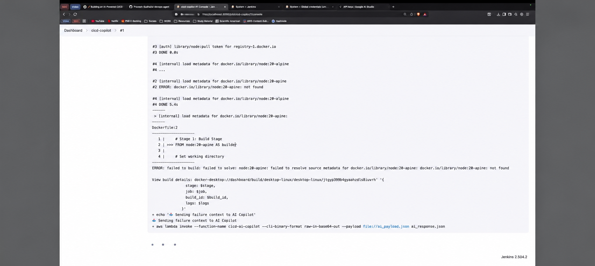
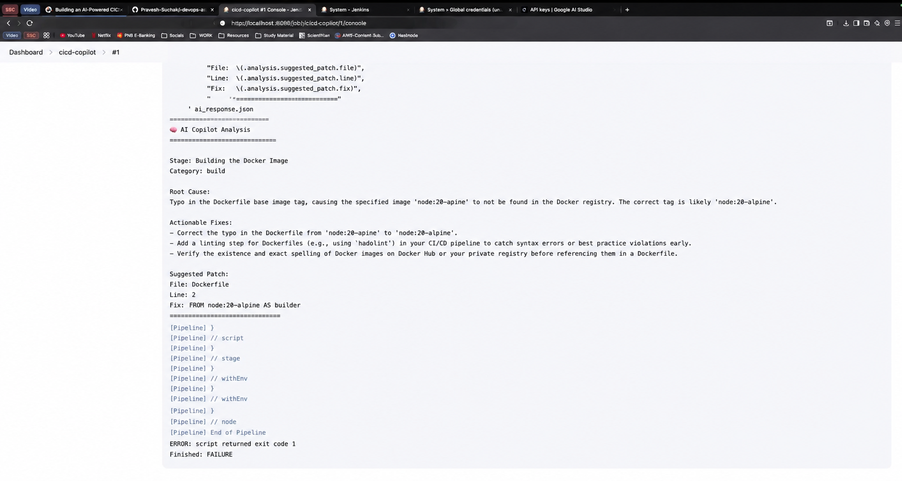

# 🚀 AI-Powered Jenkins Pipeline Failure Analyzer

> Automatically analyze Jenkins pipeline failures using Google Gemini AI and AWS Lambda to identify the root cause and suggest fixes within minutes.

---

# 📌 Overview

Debugging failed CI/CD pipelines can consume significant engineering time, especially when engineers need to inspect lengthy build logs manually.

This project automates that process by integrating **Jenkins**, **AWS Lambda**, **Python**, and the **Google Gemini API**.

Whenever a Jenkins pipeline fails during the build or deployment process, Jenkins automatically invokes an AWS Lambda function. The Lambda function extracts the pipeline logs, sends them to the Gemini API for analysis, and returns an AI-generated report containing:

* Root Cause Analysis
* Failure Summary
* Suggested Fixes
* Recommended Next Steps

The analysis is displayed directly in the Jenkins console, allowing engineers to troubleshoot failures in minutes instead of manually reviewing hundreds of log lines.

---

# 🎯 Problem Statement

Traditional CI/CD troubleshooting requires engineers to:

* Open Jenkins console logs.
* Search through hundreds or thousands of log lines.
* Identify the actual failure.
* Understand the root cause.
* Research possible solutions.
* Re-run the pipeline.

This manual workflow is repetitive and time-consuming.

This project introduces AI into the CI/CD process to automate failure analysis and reduce Mean Time to Resolution (MTTR).

---

# 💡 Solution

The solution combines Jenkins, AWS Lambda, Python, and the Google Gemini API to automatically analyze failed pipeline logs.

### Workflow

```text
                 Developer

                     │

             Push Code to Git

                     │

                     ▼

              Jenkins Pipeline

                     │

        Build → Test → Docker Build

                     │

          Deploy Docker Container

                     │

          Pipeline Success?
             /            \
           Yes            No
            │              │
            │              ▼
            │       Invoke AWS Lambda
            │              │
            │              ▼
            │      Python Script Executes
            │              │
            │              ▼
            │      Read Jenkins Console Logs
            │              │
            │              ▼
            │      Send Logs to Gemini API
            │              │
            │              ▼
            │      AI Log Analysis
            │              │
            │              ▼
            │     Root Cause + Suggested Fixes
            │              │
            │              ▼
            └──────── Return Result to Jenkins
```
---
<p align="center">
  
</p>

---

<p align="center">
  
</p>
---


# ✨ Features

* Automatic Jenkins pipeline failure detection.
* Event-driven troubleshooting using AWS Lambda.
* AI-powered log analysis with Google Gemini.
* Root cause identification.
* Suggested remediation steps.


# 🛠 Technology Stack

| Component            | Technology       |
| -------------------- | ---------------- |
| CI/CD                | Jenkins          |
| Programming Language | Python           |
| AI Model             | Google Gemini    |
| Cloud                | AWS Lambda       |
| Containerization     | Docker           |
| Version Control      | GitHub           |
| API Communication    | REST API         |

---
# 🔄 Project Workflow

## Step 1

Developer pushes code to GitHub.

↓

## Step 2

Jenkins pipeline starts.

↓

## Step 3

Application is built.

↓

## Step 4

Docker image is created.

↓

## Step 5

Application is deployed.

↓

## Step 6

If the pipeline succeeds:

* Pipeline completes successfully.

If the pipeline fails:

* Jenkins invokes an AWS Lambda function.

↓

## Step 7

AWS Lambda executes a Python script.

↓

## Step 8

The Python script:

* Collects Jenkins console logs.
* Cleans unnecessary output.
* Prepares an AI prompt.

↓

## Step 9

Logs are sent to the Google Gemini API.

↓

## Step 10

Gemini analyzes the logs and generates:

* Failure summary
* Root cause
* Error explanation
* Suggested fixes
* Confidence level
* Prevention recommendations

↓

## Step 11

Lambda returns the analysis to Jenkins.

↓

## Step 12

Jenkins prints the AI-generated report in the console output.

Engineers can immediately understand the issue and take corrective action.

---
