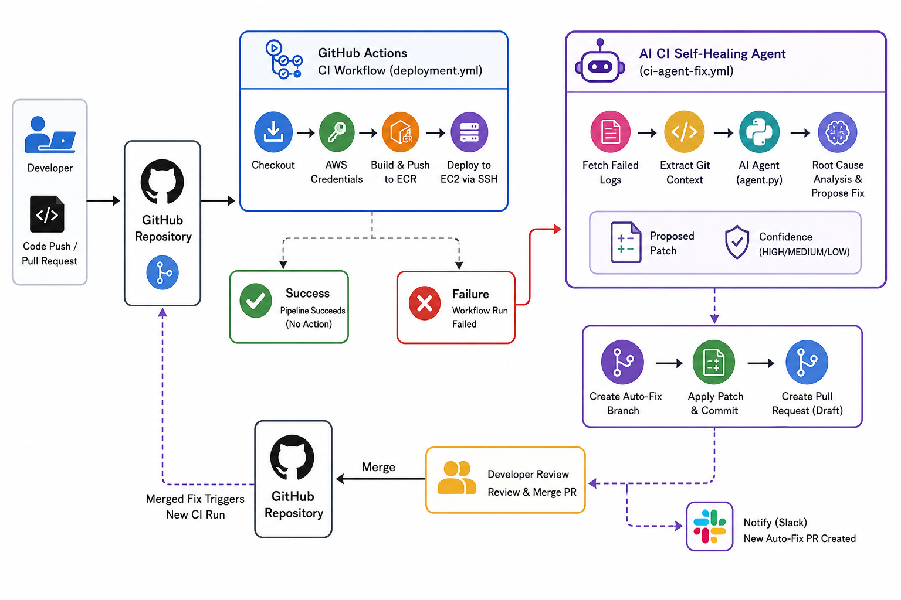

# 🤖 AI-Powered Self-Healing CI/CD Pipeline Agent

> An autonomous AI agent that monitors GitHub Actions CI/CD pipeline failures, performs root cause analysis, generates intelligent code fixes, and automatically creates pull requests to heal broken pipelines.

---

# 📖 Overview

Modern CI/CD pipelines frequently fail due to various reasons. Developers often spend valuable time manually investigating logs and fixing these issues.

This project introduces an **AI-powered Self-Healing CI/CD Agent** that automatically detects failed GitHub Actions workflows, analyzes failure logs and recent code changes, identifies the root cause using an LLM (Claude), generates a minimal patch, and opens a Pull Request containing the proposed fix.

Instead of simply notifying developers about failures, this project attempts to **repair the pipeline automatically**, significantly reducing Mean Time To Recovery (MTTR) and improving developer productivity.

---
<p align="center">
  
</p>

---

# 🚀 Project Description

The project consists of two GitHub Actions workflows.

### 1. CI Deployment Pipeline

The primary pipeline:

- Builds the application
- Creates a Docker image
- Pushes the image to Amazon ECR
- Deploys the latest image to an EC2 instance

If any step fails, GitHub automatically marks the workflow as failed.

---

### 2. AI Self-Healing Workflow

Whenever the CI workflow fails, another GitHub Action is automatically triggered.

The AI workflow:

- Fetch failure logs
- Collects Git diff
- Reads modified files
- Sends contextual information to Claude
- Generates a minimal Git patch
- Applies the patch
- Creates a new branch
- Opens a Draft Pull Request for developer review

This creates an automated feedback loop where the pipeline attempts to repair itself before developers manually intervene.

---

# 🛠 Tech Stack

| Category | Technology |
|----------|------------|
| Language | Python 3.11 |
| AI Model | Claude 3.7 Sonnet (Anthropic) |
| CI/CD | GitHub Actions |
| Version Control | Git |
| Cloud | AWS |
| CLI Tools | GitHub CLI (gh), Git |
| Infrastructure | GitHub Hosted Ubuntu Runner |

---

# ✨ Features

## 🤖 AI Root Cause Analysis

- Automatically analyzes failed workflow logs
- Reads recent code changes
- Understands modified source files
- Determines the most probable root cause

---

## 🩹 Automatic Patch Generation

The AI produces:

- Minimal Git unified diff
- Repository-relative patch
- Confidence score
- Short explanation

The patch is immediately compatible with:

```bash
git apply
```
---

## 🔄 Automated Pull Request Creation

Instead of modifying the main branch directly, the agent:

- Creates a new branch
- Applies the generated patch
- Commits the fix
- Pushes the branch
- Opens a Draft Pull Request

This keeps the system safe while allowing human review.

---

## 🛡 Safe Self-Healing

Safety mechanisms include:

- Daily execution limit
- No recursive auto-fix branches
- Draft Pull Requests
- Confidence reporting
- Minimal code modifications

---

# ⚙ How It Works

## Step 1 — Developer Pushes Code

A developer pushes changes to the **main** branch.

↓

## Step 2 — CI Pipeline Starts

GitHub Actions executes:

- Checkout repository
- Configure AWS credentials
- Login to Amazon ECR
- Build Docker image
- Push image
- Deploy application to EC2

↓

## Step 3 — Pipeline Failure

If any CI step fails:

- Docker build error
- Test failure
- Dependency issue
- Deployment issue
- Configuration mistake

GitHub marks the workflow as **Failed**.

↓

## Step 4 — Auto-Fix Workflow Starts

The second workflow listens to failed CI runs using:

```yaml
workflow_run:
```

It is automatically triggered whenever the CI workflow finishes with a failure.

↓

## Step 5 — Collect Failure Context

The agent gathers:

- Workflow logs
- Failed step logs
- Git diff
- Modified files
- Source code

↓

## Step 6 — AI Root Cause Analysis

Claude receives:

- Error logs
- Recent code changes
- Modified source files

The AI identifies the most likely root cause and generates a minimal patch.

↓

## Step 7 — Patch Validation

The generated response includes:

- Confidence Level
- Explanation
- Unified Git Patch

↓

## Step 8 — Apply Fix

If a valid patch exists:

- Create new branch
- Apply patch
- Commit changes
- Push branch

↓

## Step 9 — Open Pull Request

A Draft Pull Request is automatically created for developer review.

↓

## Step 10 — Human Review

The developer reviews the proposed fix and merges it if appropriate, completing the self-healing cycle.

---

# 📝 Step-by-Step Implementation Guide

## Step 0 Configure GitHub Secrets.

Set secrets In Github:

```text
AWS_ACCESS_KEY_ID

AWS_SECRET_ACCESS_KEY

AWS_REGION

EC2_HOST

EC2_USERNAME

EC2_SSH_KEY

GH_PAT

ANTHROPIC_API_KEY
```

---

## Step 1

Create your application .
[app](/SRE-AI-Agent/CICD-Self-Healing-Agent/src/)

---

## Step 2

Create the GitHub Actions deployment workflow.

File:

```text
.github/workflows/cicd-pipeline.yml
```
[.github/workflows/cicd-pipeline.yml](/SRE-AI-Agent/CICD-Self-Healing-Agent/.github/workflows/cicd-pipeline.yaml)

What It Do:

- Checkout
- AWS Credentials
- Docker Build
- Push to ECR
- EC2 Deployment

---

## Step 3

Create the Auto-Fix workflow.

File:

```text
.github/workflows/ci-agent-fix.yml
```
[.github/workflows/ci-agent-fix.yml](/SRE-AI-Agent/CICD-Self-Healing-Agent/.github/workflows/ci-agent-fix.yml)


Configure it to listen for failed CI workflow executions.

---

## Step 4

Implement the AI agent (`agent.py`).

Responsibilities:

- Read failure logs
- Read Git diff
- Read modified files
- Call Claude API
- Generate Git patch
- Save confidence level
- Output GitHub workflow variables

---

## Step 5

Intentionally introduce a build error.

Examples:

- Syntax error
- Missing dependency
- Invalid Dockerfile
- Broken import

Observe the CI pipeline fail.

---

## Step 6

Watch the AI workflow.

The agent automatically:

- Downloads logs
- Detects root cause
- Generates patch
- Creates auto-fix branch
- Opens Draft Pull Request

---

## Step 7

Review the generated Pull Request.

If correct:

- Merge the PR
- CI reruns successfully
- Pipeline becomes healthy again

---