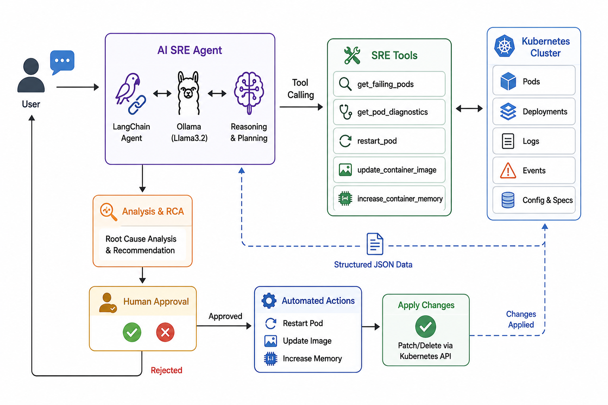

# 🤖 Kubernetes Self-Healing AI Agent with LangChain & Ollama

An AI-powered **Site Reliability Engineering (SRE) Agent** that automatically detects failing Kubernetes workloads, performs root-cause analysis, proposes safe remediation actions, and executes approved fixes using **LangChain Tool Calling**, **Ollama (Llama 3.2)**, and the **Kubernetes Python Client**.

Instead of manually debugging production incidents, the AI agent behaves like an SRE engineer—inspecting pods, analyzing logs and events, identifying deployment owners, suggesting repairs, and asking for human approval before making changes.

* Detecting unhealthy workloads
* Performing automated root cause analysis
* Suggesting infrastructure repairs
* Executing safe remediation after human approval
* Following production-grade operational safety rules

---
<p align="center">
  
</p>

---
# 🏗 Tech Stack

| Category           | Technology               |
| ------------------ | ------------------------ |
| Language           | Python 3                 |
| AI Model           | Llama 3.2 (Ollama)       |
| AI Framework       | LangChain                |
| Tool Calling       | LangChain Tools          |
| Container Platform | Kubernetes               |
| Local Cluster      | Kind                     |
| Kubernetes SDK     | Kubernetes Python Client |
| Runtime            | Docker                   |

---

# ⚙ How It Works

The AI agent operates as an autonomous reasoning loop.

## Step 1

User sends an operational request.

Example:

```
Check the cluster for failing pods.
```

---

## Step 2

The LLM decides which tool should execute first.

```
get_failing_pods()
```

---

## Step 3

The tool scans the namespace.

Example output:

```json
[
  {
    "pod_name":"web-app",
    "reason":"ImagePullBackOff"
  },
  {
    "pod_name":"memory-hog",
    "reason":"OOMKilled"
  }
]
```

---

## Step 4

For every failed Pod, the AI gathers diagnostics.

```
get_pod_diagnostics()
```

Collected information includes:

* Active logs
* Previous logs
* Events
* Resources
* Images
* Deployment owner

---

## Step 5

The LLM reasons about the failure.

Examples:

**OOMKilled**

↓

Increase memory

---

**CrashLoopBackOff**

↓

Inspect logs

↓

Restart Pod

---

**ImagePullBackOff**

↓

Suggest updating image

---

## Step 6

Before executing any mutation, the system pauses.

```
Approve this repair? (y/n)
```

---

## Step 7

After approval, the selected Kubernetes tool executes.

Examples:

```
restart_pod()
```

```
increase_container_memory()
```

```
update_container_image()
```

---

## Step 8

The repair result is returned to the LLM, allowing it to continue reasoning until the incident is resolved.

---

# 🔄 Workflow

```text
User
 │
 ▼
Ask AI to inspect cluster
 │
 ▼
LLM receives request
 │
 ▼
Scan namespace
 │
 ▼
Find unhealthy Pods
 │
 ▼
Collect diagnostics
 │
 ▼
Analyze logs + events
 │
 ▼
Determine root cause
 │
 ▼
Select repair action
 │
 ▼
Ask human approval
 │
 ▼
Execute Kubernetes Tool
 │
 ▼
Return repair status
 │
 ▼
Incident resolved
```

---

# 🚀 Step-by-Step Implementation Guide

## Step 1 — Install Python Dependencies

```bash
pip install -r requirements.txt
```
---

## Step 3 — Install Ollama

Download Ollama:

https://ollama.com

Pull the Llama model:

```bash
ollama pull llama3.2
```

Verify:

```bash
ollama list
```

---

## Step 4 — Create Local Kubernetes Cluster

Run:

```bash
chmod +x setup.sh

./setup.sh
```

The script:

* Creates Kind cluster
* Deploys broken workloads
* Waits for failures
* Displays Pod status

---

## Step 5 — Deploy Chaos Applications

- [chaos_example](/SRE-AI-Agent/K8-Self-Healing-Agent/chaos/broken-image.yaml)

This repository intentionally deploys failing applications.

Examples include:

### ImagePullBackOff

```yaml
image: nginx:latestt
```

---

### Missing ConfigMap

```yaml
envFrom:
  configMapRef:
    name: app-config
```

---

### OOMKilled

```yaml
resources:
  limits:
    memory: 10Mi
```

---

## Step 6 — Start the AI Agent

```bash
python main.py
```

The agent begins monitoring the namespace.

---

## Step 7 — AI Discovers Failures

Example:

```text
web-app

ImagePullBackOff
```

```text
memory-hog

OOMKilled
```

---

## Step 8 — AI Performs Diagnostics

The agent automatically collects:

* Logs
* Previous logs
* Events
* Resources
* Images
* Deployment owner

---

## Step 9 — AI Suggests Repairs

Example:

```text
Increase memory

Restart Pod

Update image
```

---

## Step 10 — Approve Repairs

Example:

```text
Approve this repair action?

(y/n)
```

---

## Step 11 — Kubernetes Executes Repair

Example:

```text
Deployment updated

Memory increased

Pod restarted
```

---

## Step 12 — Incident Resolved

The agent returns the repair result and completes the workflow.

---