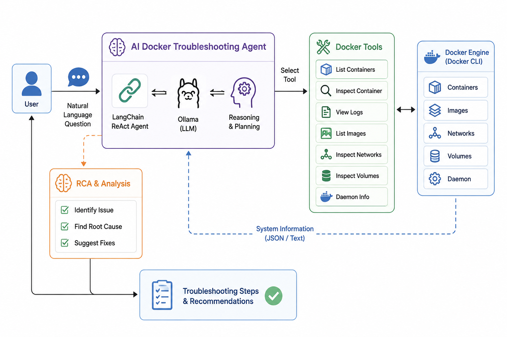

# 🐳 Docker Troubleshooting Agent

An **AI-powered Docker Troubleshooting Agent** built with **LangChain**, **Ollama**, and **Docker CLI** that helps DevOps engineers diagnose Docker issues using natural language.

The agent analyzes Docker containers, images, networks, volumes, and daemon status, performs root cause analysis (RCA), and provides actionable troubleshooting recommendations.

---
<p align="center">
  
</p>

---

## ✨ Features

- 🤖 AI-powered Docker troubleshooting
- 🔍 Root Cause Analysis (RCA) for container failures
- 📦 Inspect running and stopped containers
- 📝 Analyze container logs


---

# 📁 Project Structure

```text
docker-troubleshooter-agent/
│
├── main.py                 # CLI entrypoint
├── config.py               # Model & prompt configuration
├── tools.py                # Docker tools
├── requirements.txt
├── README.md
└── .env
```

---

# 🚀 How It Works

1. User asks a Docker-related question.
2. LangChain ReAct Agent understands the request.
3. Agent selects the appropriate Docker tool.
4. Docker CLI collects system information.
5. Ollama analyzes the results.
6. Agent performs Root Cause Analysis.
7. AI returns troubleshooting steps and recommendations.

---

# 🛠️ Prerequisites

- Python 3.10+
- Docker Desktop 
- Ollama
- Docker CLI installed
- A supported Ollama model

---

## 2. Create Virtual Environment

Linux/macOS

```bash
python3 -m venv venv

source venv/bin/activate
```

Windows

```powershell
python -m venv venv

venv\Scripts\activate
```

---

## 3. Install Dependencies

```bash
pip install -r requirements.txt
```

---

## 4. Install Ollama

Download from

https://ollama.com

---

## 5. Pull a Model

Example

```bash
ollama pull llama3.2
```

or

```bash
ollama pull qwen2.5
```

---

## 6. Configure

Example `config.py`

```python
MODEL_NAME = "llama3.2"

TEMPERATURE = 0.2
```

---

# ▶️ Run

```bash
python main.py
```

Example

```text
🐳 Docker Troubleshooter Agent (RCA Enabled)

---------------------------------------------

Ask about your Docker containers.

Type 'quit' to exit.
```

---

# 💬 Example Questions

```text
Why is my container restarting continuously?

```

```text
Show logs for nginx container.

```
```text
Which containers are unhealthy?

```


That's it. LangChain wires up the ReAct loop — the LLM reasons, picks a tool, we run it, feed the result back, repeat.

## Try It

First, create a broken container:

```bash
docker run -d --name broken-app nginx:alpine sh -c "echo 'app starting...' && sleep 2 && exit 1"
```

Then run the agent:

```bash
python3 agent.py
```

Ask it:
- "Why is broken-app crashing?"
- "What containers are running?"
- "Show me the logs for broken-app"

Watch it decide which tools to call on its own.

Clean up when done:

```bash
docker rm -f broken-app
```
