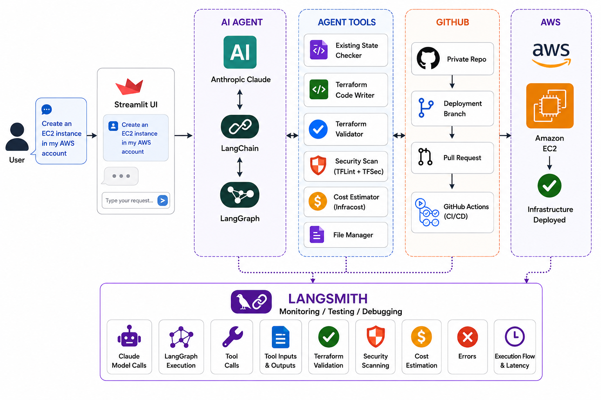

# 🚀 Terraform AI Agent — AWS Infrastructure Provisioner

## 🏗️ Overview

**Terraform AI Agent** is an AI-powered AWS infrastructure provisioning platform that converts natural-language infrastructure requirements into production-oriented Terraform configurations.

Instead of manually writing Terraform configuration, users can describe the infrastructure they need through a conversational Streamlit interface. The AI agent analyzes the request, generates the required Terraform configuration, validates it, performs security checks, estimates infrastructure cost, and presents the generated infrastructure for human review.

Once the user approves the generated infrastructure, the platform automatically creates a private GitHub repository, pushes the Terraform configuration, creates a deployment branch, and opens a Pull Request containing the infrastructure changes.

The project combines **Claude, LangChain, LangGraph, Terraform, security analysis, cost estimation, and GitHub Actions** into a single automated workflow.

**User Request → AI Reasoning → Infrastructure Generation → Terraform Validation → Security Analysis → Cost Estimation → Human Review → GitHub Pull Request → CI/CD Deployment**

**LangSmith integrated for AI agent monitoring, tracing, and observability.**
---

  

---

# 🎯 Project Goals

The primary goals of the project are:

* Simplify AWS infrastructure provisioning.
* Allow users to describe infrastructure using natural language.
* Automate Terraform configuration generation.
* Validate generated infrastructure before deployment.
* Detect Terraform configuration and security problems automatically.
* Estimate infrastructure costs before deployment.
* Support existing Terraform infrastructure.
* Maintain a human approval step before deployment.
* Integrate infrastructure changes with GitHub-based CI/CD.
* LangSmith integrated for AI agent monitoring, tracing, and observability.
* Provide a repeatable AI-assisted Infrastructure-as-Code workflow.

---
## 🧰 Tech Stack

| Category                    | Technology             | Purpose                                                                        |
| --------------------------- | ---------------------- | ------------------------------------------------------------------------------ |
| 🤖 AI Model                 | **Anthropic Claude**   | Understands infrastructure requirements and generates Terraform configurations |
| 🧠 AI Framework             | **LangChain**          | Connects the AI model with tools and application logic                         |
| 🔄 Agent Workflow           | **LangGraph**          | Manages the agent's state, tool execution, and reasoning workflow              |
| 📊 Agent Monitoring         | **LangSmith**          | Provides tracing, monitoring, debugging, and observability for AI agent executions
| 🏗️ Infrastructure as Code  | **Terraform**          | Defines and provisions AWS infrastructure                                      |
| ☁️ Cloud Platform           | **AWS**                | Target cloud platform for infrastructure provisioning                          |
| 🖥️ Frontend / UI           | **Streamlit**          | Provides the conversational web interface                                      |
| 🔐 Security Scanning        | **TFSec**              | Identifies security misconfigurations in Terraform                             |
| 💰 Cost Estimation          | **Infracost**          | Estimates monthly cloud infrastructure costs                                   |                                 
| ⚙️ CI/CD                    | **GitHub Actions**     | Runs Terraform plan and apply workflows                                        |
| 🐳 Containerization         | **Docker**             | Packages the AI agent and infrastructure tooling                               |
| 🧩 Container Orchestration  | **Docker Compose**     | Runs the application and its environment locally                               |
| 🐍 Programming Language     | **Python**             | Implements the application, agent, and Terraform tools                         |

### 🔄 How It Works

1. 🚀 **User Request** — Describe the required AWS infrastructure in natural language.
2. 🤖 **AI Reasoning** — Claude analyzes the request and plans the infrastructure.
3. 🔍 **State Check** — Existing Terraform state is checked when modifying infrastructure.
4. 🏗️ **Terraform Generation** — AI generates and writes the Terraform configuration.
5. ✅ **Validation** — Terraform formatting and validation are performed.
6. 🔁 **Validation Failed** — If validation fails, the AI fixes and regenerates the Terraform configuration.
7. 🔐 **Security Scan** — TFLint and TFSec scan the generated infrastructure.
8. 🔁 **Security Failed** — If HIGH/CRITICAL issues are found, the AI fixes and regenerates the configuration.
9. 💰 **Cost Estimation** — Infracost estimates the expected monthly AWS cost.
10. 👀 **Human Review** — Generated Terraform files are presented for user approval.
11. 🐙 **GitHub PR** — Approved infrastructure is pushed to GitHub and a Pull Request is created.
12. ⚙️ **CI/CD Deployment** — GitHub Actions runs Terraform Plan and Apply.
13. ☁️ **AWS Provisioning** — Approved infrastructure is deployed to AWS.
14. 📊 Agent Monitoring — LangSmith traces and monitors the AI agent execution.

**Core loop:**
`Generate → Validate → Fix if Failed → Security Scan → Fix if Failed → Cost → Review → Deploy`

# ✨ Features

- 🤖 Natural Language Infrastructure

- 🧠 AI-Powered Terraform Generation

- 🔄 Existing Infrastructure Awareness

- ✅ Automatic Terraform Validation

- 🔐 Automated Security Scanning

- 💰 Cost Estimation

- 👀 Human Review

---

# 🛠️ Step-by-Step Implementation Guide

Follow these steps to build and run the Terraform AI Agent.

### 1. Install Dependencies

Install all required Python packages from the project dependency file.

**File:** [requirements.txt](/Terraform-AI-Agent/requirements.txt)

**Command:** `pip install -r requirements.txt`

---

### 2. Configure Environment Variables

Create the environment configuration file and add the required API keys and cloud credentials.

**File:** [.env](/Terraform-AI-Agent/.env.example)

Configure credentials for:

* Anthropic
* LangChain
* GitHub
* Infracost
* AWS

---

### 3. Create the Terraform Tool Layer

Create the tools responsible for interacting with Terraform and infrastructure utilities.

**File:** [tools/terraform_tools.py](/Terraform-AI-Agent/tools/terraform_tools.py)

Implement tools for:

* Reading existing Terraform state
* Writing Terraform files
* Formatting and validating Terraform
* Running TFLint and TFSec
* Estimating infrastructure cost with Infracost

---

### 4. Create the Agent State

Define the state structure used to maintain messages throughout the agent workflow.

**File:** [agent/state.py](/Terraform-AI-Agent/agent/state.py)

Add the message state required by LangGraph.

---

### 5. Create Agent Tools and System Prompt

Connect the Terraform functions to the AI agent and define the agent's execution rules.

**File:** [agent/nodes.py](/Terraform-AI-Agent/agent/nodes.py)

Configure:

* Existing infrastructure checker
* Terraform code writer
* Terraform validator
* Security scanner
* Cost estimator
* Claude model
* Agent system prompt

---

### 6. Build the LangGraph Workflow

Create the agent workflow and define how the model and tools interact.

**File:** [agent/graph.py](/Terraform-AI-Agent/agent/graph.py)

Configure the flow:

**Start → Agent → Tools → Agent → End**

---

### 7. Build the Streamlit Application

Create the user interface for submitting infrastructure requests and reviewing generated Terraform.

**File:** [app.py](/Terraform-AI-Agent/app.py)

Implement:

* Chat interface
* Agent execution
* Generated file display
* Review workflow
* Approve and deploy action
* Discard action

---

### 8. Create the Terraform Workspace

Create the workspace directory used by the agent to store generated Terraform files.

**Directory:** `workspace/`

Use this directory for:

* Terraform configuration
* Backend configuration
* Validation
* Security scanning
* Cost estimation
* Git operations

---

### 10. Create the Docker Image

Create a Docker image containing the application and required infrastructure tools.

**File:** [Dockerfile](/Terraform-AI-Agent/Dockerfile)

Include:

* Python
* Terraform
* TFLint
* TFSec
* Infracost
* Git
* GitHub CLI

---

### 11. Configure Docker Compose

Create the service definition for running the Terraform AI Agent locally.

**File:** [docker-compose.yml](/Terraform-AI-Agent/docker-compose.yml)

Configure:

* Application service
* Port `8501`
* Environment variables
* Required API keys
* AWS credentials

---

### 12. Build and Start the Application

Build the Docker image and start the application using Docker Compose.

**Command:** `docker compose up --build`

---

### 13. Open the Streamlit Application

Open the Streamlit application in your browser.

**URL:** `http://localhost:8501`

---

### 14. Submit an Infrastructure Request

Enter an AWS infrastructure requirement in natural language through the Streamlit chat interface.

The agent will:

**Understand → Generate → Validate → Scan → Estimate Cost**

---

### 15. Review Generated Terraform

Review the generated Terraform files displayed in the Streamlit interface.

Verify the architecture, resources, security configuration, and estimated cost before proceeding.

---

### 16. Create Repository and Pull Request

Click **Create Repo & Open PR** after reviewing the generated infrastructure.

The application will:

* Create a private GitHub repository
* Push the Terraform configuration
* Create a deployment branch
* Push the branch
* Create a Pull Request

---

### 17. Review Terraform Plan

Open the generated GitHub Pull Request and review the Terraform Plan produced by GitHub Actions.

---

### 18. Merge the Pull Request

After reviewing and approving the infrastructure changes, merge the Pull Request into the main branch.

---

### 19. Deploy Infrastructure

GitHub Actions automatically runs the Terraform Apply workflow after the approved changes reach the main branch.

The requested AWS infrastructure is then provisioned or updated.
---

### 20. Implement AI Agent Monitoring with LangSmith

Add LangSmith monitoring to trace and observe the Terraform AI Agent.

**Step 1 — Configure LangSmith Environment Variables**

Add the following configuration to `.env`:

* `LANGCHAIN_API_KEY`
* `LANGCHAIN_TRACING_V2`
* `LANGCHAIN_PROJECT`

Set LangChain tracing to enabled and provide a project name for the Terraform AI Agent.

**Step 2 — Configure LangSmith in Docker**

Add the LangSmith environment variables to `docker-compose.yml` so they are available inside the agent container.

**Step 3 — Run the Agent**

Start the application and submit an infrastructure request through Streamlit.

The agent execution will generate a LangSmith trace containing the AI workflow.

**Step 4 — Monitor Agent Execution**

Open the configured LangSmith project and inspect:

* 🤖 Claude model calls
* 🔄 LangGraph execution
* 🛠️ Tool calls
* 📝 Tool inputs and outputs
* ✅ Terraform validation
* 🔐 Security scanning
* 💰 Cost estimation
* ❌ Errors
* ⏱️ Execution flow and latency
